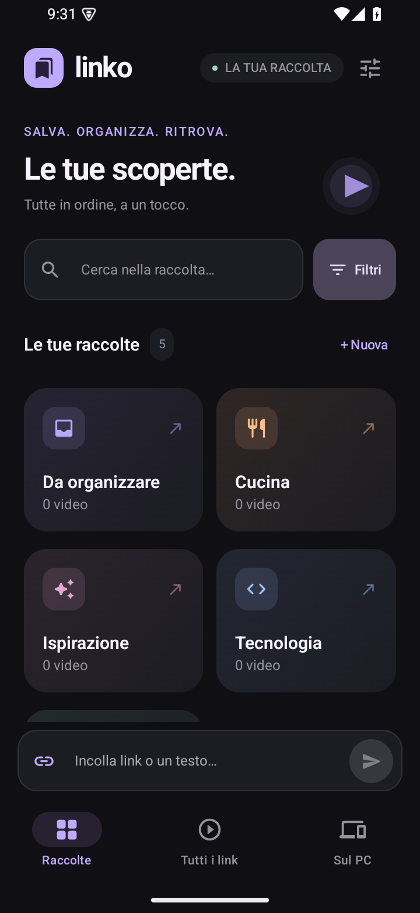
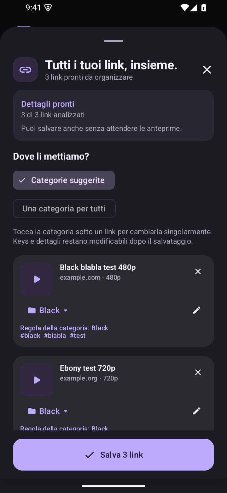
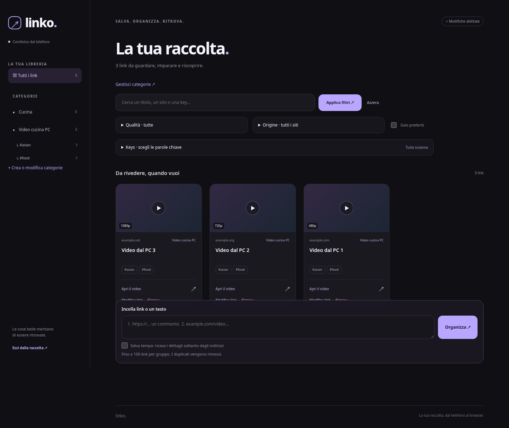

# Linko

Linko is an Android app for saving, organizing, and rediscovering video links. Your library stays on your phone and works without a Linko account. When you want to browse it on a computer, you can start a password-protected server on your phone and choose which collections to share.

| Android library | Bulk import | Browser library |
| --- | --- | --- |
|  |  |  |

## Features

- Save a link from Android's share menu or paste up to 100 links at once, even from text with comments and duplicates.
- Review suggested titles, previews, categories, and keywords before saving. Linko uses the URL for suggestions when a page's metadata is unavailable.
- Organize links with custom categories and keyword rules. Frequently used keywords form smart collections automatically.
- Find links with search and combined filters for keywords, video quality, and source domains.
- Browse selected collections from a computer and optionally add or edit links in the browser.
- Export and restore your library as a JSON backup.

The Android and browser interfaces are currently in Italian. The [user guide](docs/user-guide.md) includes the Italian menu labels. Saved links open in your browser or a compatible app.

## Build and install

Linko requires Android 8.0 or later (API 26). You can download the `linko-debug-apk` artifact from a successful Android CI run while signed in to GitHub. [Android CI runs](https://github.com/elchemista/Linko/actions/workflows/android.yml)

For a local build, install JDK 17 and Android SDK Platform 35, then set `ANDROID_HOME` to your SDK directory or let Android Studio configure it.

```sh
./gradlew :app:assembleDebug
adb install -r app/build/outputs/apk/debug/app-debug.apk
```

To use `adb`, connect an Android device with USB debugging enabled or start an emulator. You can also copy the APK to your phone and open it there. Android requires matching signing keys to update an installed copy in place. Export a JSON backup before uninstalling an existing copy.

## Development

```sh
./gradlew :app:testDebugUnitTest :app:lintDebug
```

Android CI runs unit tests, Android Lint, and a debug build. The development guide covers the project layout and on-device checks. [CI workflow](.github/workflows/android.yml) · [Development guide](docs/development.md)

## License

Linko is licensed under the MIT License. [License text](LICENSE)
